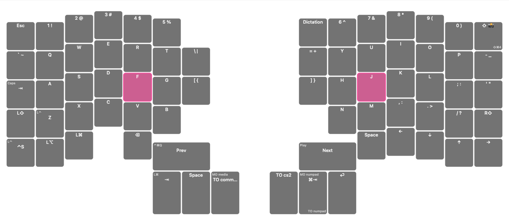

# Moonlander Overlay

A macOS menu-bar app that draws a wide, transparent Moonlander layout above other windows.
A native Swift/AppKit panel renders the keycaps; a bundled Rust helper reads the board's
active layer and physical key presses directly over HID.

**Keymapp and its API are not runtime dependencies.** Keymapp is used occasionally to sync
layout data from Oryx into its local cache. The overlay never flashes firmware.



*Layer 0 (qwerty) with live held-key highlights on F and J. Rendered offscreen by the
same `KeyboardView` drawing code the app uses, on a dark backdrop for legibility —
the real overlay is transparent and floats above other windows.*

## Quick start

```sh
cd ~/dev/apps/zsa-overlay
./scripts/setup.sh          # first run: checks tools, imports YOUR layout, builds
open "build/Moonlander Overlay.app"
```

Already set up and just rebuilding? `./scripts/build-app.sh` is enough.

Disconnect the board in Keymapp or quit Keymapp before enabling **Follow Keyboard**.
With the tested HID backend, only one process can own the board's raw-HID interface.
The app has a keyboard icon in the menu bar, not a Dock icon.

- Toggle visibility: **Control–Option–K**.
- Quit: menu → **Quit**.
- Hiding the overlay or selecting a manual layer releases the HID interface.
- To use Keymapp without quitting the overlay: **Release Keyboard (Manual Reference)**,
  then connect the board in Keymapp. After syncing, disconnect/quit Keymapp and select
  **Follow Keyboard** again.

## Requirements

- macOS 14 or later.
- Swift 6.2+ / Xcode command-line tools.
- Rust and Cargo.
- A connected Moonlander with compatible Oryx firmware: the helper currently supports
  **Oryx HID protocol version 5**, verified on `GMrOw/rba3al`.
- Python 3 for importing updated legends; Keymapp for populating its local layout cache.

The direct raw-HID interface did not require Input Monitoring or Accessibility permission
on the tested Mac. Global-hotkey registration also does not require Accessibility permission.
There is no gRPC client, Unix socket, or `protoc` build requirement anymore.

## Supported hardware

- **Moonlander Mark I** only: 72 keys, USB IDs `3297:1969`, Oryx raw-HID interface
  (usage page `0xff60`, usage `0x61`), **protocol version 5**.
- One board at a time; multiple connected Moonlanders are refused rather than guessed.
- Not supported (yet): Voyager, Ergodox EZ, Planck EZ, or any non-ZSA board. The
  board-specific pieces (`MoonlanderMatrix`, the 72-key validation, the HID interface
  IDs) are deliberately isolated so a second board can be added side by side.

The repo is named `zsa-overlay` for where this is going; the app stays
**Moonlander Overlay** because that is what it supports today. It earns the broader
name when a second board lands.

## Controls

| Action | Control |
|---|---|
| Show/hide | Control–Option–K or the menu item |
| Hide while the panel receives key events | Escape |
| Follow live layer and highlight held keys | **Follow Keyboard** |
| Release HID ownership without quitting | **Release Keyboard (Manual Reference)** |
| Display one reference layer without reading the board | **Layer** submenu; selection is remembered |
| Pass clicks to applications underneath | **Pinned (click-through)** |
| Resize | Drag an edge/corner; bottom-right notch shows the affordance, or use **Larger/Smaller** |
| Reconnect the HID helper | **Retry Keyboard Connection** |
| Re-read legends and board identity | **Reload Layout** |
| Locate the loaded legend file | **Reveal Layout File** |

The grip disappears in click-through mode. Minimum panel size is 420×150. Keycaps fit the
window without changing their aspect ratio; secondary legends disappear at small sizes.
Disabled bindings are faint outlines. Transparent/inherited bindings show `↧` because the
board reports the highest active layer, not the full active-layer stack.

## Layout IDs are not layout data

The board's USB serial has the form **`<layout ID>/<revision ID>`**, such as `GMrOw/rba3al`.
It identifies the flashed layout but contains **no key assignments, tap/hold labels, macros,
or layer definitions**. The USB identity check compares that revision with the imported
`keymap.json` and warns on a mismatch; it does not download legends.

```sh
"build/Moonlander Overlay.app/Contents/MacOS/MoonlanderOverlay" --print-identity
```

The overlay reads USB identity on launch, show, Reload Layout, and a newly established live
connection. A missing/unreadable identity is not reported as a match. It does not check Oryx
for newer revisions.

## Updating layouts

1. Edit in Oryx and flash the intended firmware with Keymapp or `zapp`.
2. Release the overlay's HID connection (hide it, select a manual layer, or quit).
3. Open Keymapp and connect the Moonlander so the intended revision is present in its cache.
   **No API needs to be enabled.** Disconnect the board in Keymapp or quit when finished.
4. Read the board's revision and import that explicit revision:

   ```sh
   cd ~/dev/apps/zsa-overlay
   "build/Moonlander Overlay.app/Contents/MacOS/MoonlanderOverlay" --print-identity
   # Example output: GMrOw/rba3al

   python3 scripts/import-keymapp.py --revision rba3al \
     --output Sources/MoonlanderOverlayKit/Resources/keymap.json
   ./scripts/build-app.sh
   ```

   Replace `rba3al` with the revision you actually flashed. The importer opens the cache
   read-only and requires `--revision`; it never guesses "latest". An unknown revision lists
   the available IDs. It defaults to the first existing cache location, preferring the
   direct-download build:

   ```text
   ~/Library/Application Support/.keymapp/keymapp.sqlite3
   ~/Library/Containers/io.zsa.keymapp/Data/Library/Application Support/.keymapp/keymapp.sqlite3
   ```

   If both exist and the default is stale, use `--cache "/full/path/to/keymapp.sqlite3"`.
5. Quit the old overlay instance and launch the rebuilt bundle. Select **Follow Keyboard**.
   A rebuild changes bundled resources on disk but does not reload the already-running app.

For testing another legend file without a rebuild, launch the executable with
`MOONLANDER_KEYMAP=/absolute/path/keymap.json` and use **Reload Layout** after replacing it.
Do not edit files inside a signed `.app`; regenerate source resources and rebuild instead.

### Flashing with zapp

```sh
zapp --help
zapp flash --help
```

`zapp flash` accepts a firmware file or an Oryx URL and flashes the board. `zapp update`
uses the board's USB IDs to find a newer Oryx firmware revision and can flash it automatically.
Neither command populates the legend cache used by this importer. Release the overlay's HID
connection before flashing. The overlay sends no flash, bootloader, RGB, or layer-selection
commands.

## Architecture

```text
Sources/MoonlanderOverlay/App.swift        menu bar, hotkey wiring, single-instance hand-off
Sources/MoonlanderOverlayKit/
  Keymap.swift                            imported layout model and validation
  KeyboardIdentity.swift                  read-only USB layout/revision identity
  KeyboardStateClient.swift               helper lifecycle and ordered JSON snapshot stream
  MoonlanderMatrix.swift                  physical matrix position → Oryx key ID
  KeyboardView.swift                      keycaps, held-key highlights, resize grip
  OverlayResize.swift                     pure anchored resize maths
  OverlayPanel.swift                      nonactivating transparent floating panel
  OverlayController.swift                 live/manual state, geometry, identity warning
  GlobalHotKey.swift                      Carbon global shortcut
Sidecar/                                  direct hidapi reader, protocol decoder, snapshots
scripts/import-keymapp.py                  explicit-revision, read-only legend import
scripts/build-app.sh                       release build, bundle assembly, local ad-hoc signing
```

Physical keys are identified by matrix row/column, independent of their output keycodes.
A held key remains highlighted across layer changes until its release. Disabled and inherited
positions can also highlight. Highlights clear when the connection is lost, becomes stale,
or the overlay releases the device. Manual reference mode deliberately does not own HID
and does not show live presses.

The helper selects the Moonlander's raw interface only: VID `0x3297`, PID `0x1969`, usage page
`0xff60`, usage `0x61`. It checks protocol version 5, establishes the Oryx session, and receives
the initial layer immediately. Changes are emitted immediately; periodic full snapshots
provide a heartbeat. A held key at initial attachment cannot be reconstructed until the
board emits its event—the protocol supplies no current-held-key snapshot.

### Helper diagnostics

Release the overlay's keyboard connection first, or the diagnostics will see it as busy:

```sh
./Sidecar/target/release/moonlander-keyboard-state --help
./Sidecar/target/release/moonlander-keyboard-state --once
./Sidecar/target/release/moonlander-keyboard-state --watch --interval-ms 200
```

Each stdout line is a full state snapshot:

```json
{"state":"connected","layer":0,"pressed":[{"row":2,"column":1}],"message":"","keyboard":"Moonlander Mark I"}
```

States are `connected`, `busy`, `disconnected`, and `unavailable`. Non-connected states carry
no live layer and an empty pressed list. `--once` exits 0 for connected, 1 for non-connected;
bad usage exits 2. Diagnostics are on stderr. No key-history file is written by the app/helper.
A terminal `--watch` session exposes live physical-key positions; avoid saving it unnecessarily.

The app uses the helper bundled in `Contents/Helpers/moonlander-keyboard-state`.
`MOONLANDER_SIDECAR=/absolute/path/to/helper` is available for development. Hiding the overlay,
entering manual mode, or quitting stops the helper and releases the interface.

### Protocol evidence

Verified firmware prefixes:

| Report prefix | Meaning |
|---|---|
| `fe 05 fe` | Oryx protocol version 5 |
| `04 fe` | Session established |
| `05 <layer> fe` | Highest active layer |
| `06 <column> <row> fe` | Physical key down |
| `07 <column> <row> fe` | Physical key up |

Definitions are published in ZSA's
[protocol header](https://github.com/zsa/qmk_modules/blob/13890cd7856175de20798689d15ba6a46bf0c5c7/oryx/oryx.h)
and [firmware implementation](https://github.com/zsa/qmk_modules/blob/13890cd7856175de20798689d15ba6a46bf0c5c7/oryx/oryx.c).
Trailing bytes after the `0xfe` terminator are undefined and ignored, not decoded as timestamps.
Future firmware/protocol changes may require updating the reader.

## Troubleshooting

| Symptom | What to do |
|---|---|
| Keyboard busy/in use | Disconnect/quit Keymapp, close another HID probe/helper, then retry. Do not start two helpers together |
| No Moonlander connected | Check the USB cable and that the board is not in its bootloader |
| Unsupported protocol | Update the reader for that protocol; it deliberately refuses to guess |
| No keyboard state / not live | Retry the keyboard connection; inspect helper `--once` output after releasing the app's connection |
| Keymapp cannot connect | Hide the overlay or use **Release Keyboard (Manual Reference)** first |
| Presses do not highlight | Enable **Follow Keyboard** and establish HID; manual reference mode releases the connection |
| Board/overlay revision mismatch | Sync Keymapp, import the flashed revision, rebuild and relaunch |
| Importer says revision absent | Check its available-ID list and `--cache`; the other build's cache may be stale |
| Hotkey fails | Another app may have registered it; use the menu. Failure is reported on stderr |

## Verification

```sh
swift test
cargo test --manifest-path Sidecar/Cargo.toml
./scripts/build-app.sh
codesign --verify --deep --strict "build/Moonlander Overlay.app"
```

Tests cover layout validation and inheritance, physical matrix boundaries, HID protocol decoding
and held-state transitions, JSON stream boundaries, USB identity parsing, and resize anchoring.
Runtime smoke separately exercised the real board handshake, Keymapp/reader exclusivity,
stale-state recovery after pausing the helper, manual-mode release, rapid hide/show,
stopped-child cleanup, broken-pipe exit, and shutdown without orphaned readers.
Native held/released keycap surfaces were also rendered and inspected.

## Pre-cutover checkpoint

Git commit **`c96521a`** records the working Keymapp-API version before this cutover, including
its dependencies, layout data and build script. Build artifacts are excluded from Git and
recreated by the script. The current version uses direct HID only; there is no API fallback.

## License

MIT — see [LICENSE](LICENSE). You may use, fork, and sell builds of this software;
the license notice must ship with substantial copies.
